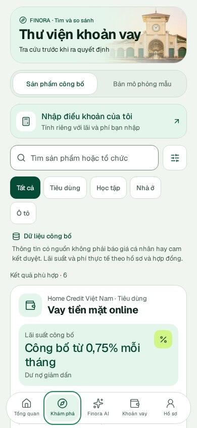
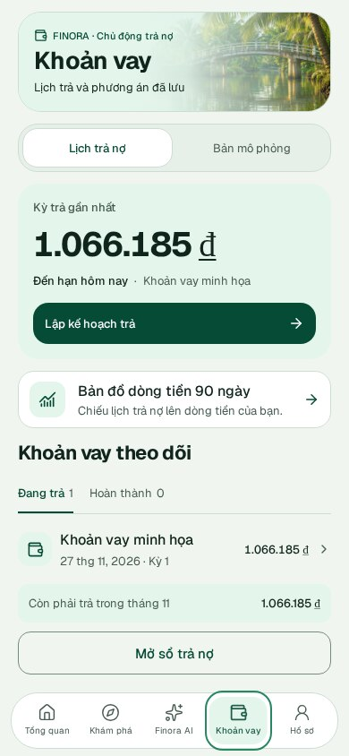
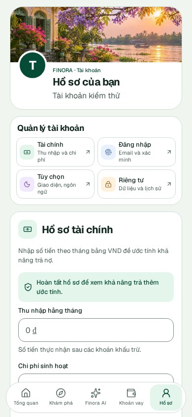
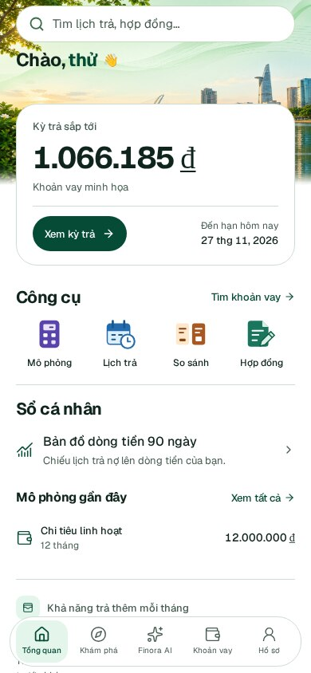
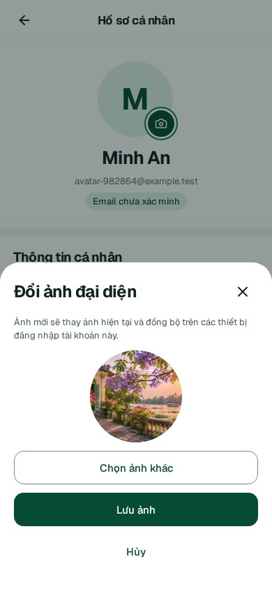

<p align="center">
  <picture>
    <source media="(prefers-color-scheme: dark)" srcset="apps/app/assets/brand/lockup-night.png">
    
  </picture>
</p>

<h1 align="center">Vay thông minh, trả chủ động.</h1>

<p align="center">
  Hiểu mình sẽ trả bao nhiêu trước khi vay.<br>
  Theo dõi từng kỳ và chuẩn bị dòng tiền sau khi vay.
</p>

<p align="center">
  <a href="#giao-diện">Giao diện</a> ·
  <a href="#luồng-dùng-thử">Luồng dùng thử</a> ·
  <a href="#chạy-trên-máy">Chạy trên máy</a> ·
  <a href="#mã-nguồn-và-tài-liệu">Tài liệu kỹ thuật</a> ·
  <a href="#khai-báo-bài-dự-thi-momo">Khai báo dự thi</a>
</p>

---

FINORA là trợ thủ khoản vay dành cho người dùng Việt Nam. Trước khi vay, bạn có thể đối chiếu điều kiện được công bố và mô phỏng từng kỳ trả nợ. Khi đã vay, bạn có thể theo dõi nghĩa vụ đến hạn và xem chúng ảnh hưởng thế nào đến dòng tiền.

**FINORA không cấp tín dụng, không nhận hồ sơ xin vay, không quyết định duyệt vay và không thực hiện thanh toán.**

## Giao diện

|                                                                                    Khám phá                                                                                    |                                                                                       Khoản vay                                                                                       |                                                                                     Hồ sơ                                                                                      |
| :----------------------------------------------------------------------------------------------------------------------------------------------------------------------------: | :-----------------------------------------------------------------------------------------------------------------------------------------------------------------------------------: | :----------------------------------------------------------------------------------------------------------------------------------------------------------------------------: |
| [](docs/product-design/media/explore-390-light.jpg) | [](docs/product-design/media/loans-390-light.jpg) | [](docs/product-design/media/profile-390-light.jpg) |

_Ảnh chụp từ bản Expo Web ở chiều rộng 390 px, dùng dữ liệu kiểm thử. Bấm ảnh để xem nguyên kích thước._

<details>
<summary>Xem thêm Tổng quan và Chat với Fin</summary>
<br>
<p>
  <a href="docs/product-design/media/home-390-reference.jpg"></a>
  <a href="docs/product-design/media/fin-390-reference.jpg"></a>
</p>
</details>

## Luồng dùng thử

1. **Tìm và đối chiếu.** Mở **Khám phá** để xem điều kiện công bố và nguồn gốc thông tin. Danh mục sản phẩm mẫu được tách riêng để thử mô phỏng.
2. **Tính từng kỳ.** Chọn sản phẩm mẫu hoặc nhập điều khoản của bạn. Kiểm tra số tiền, lãi suất, kỳ hạn và ngày trả đầu tiên, rồi chọn **Tính lịch trả nợ**. Phí chưa biết không được coi là bằng 0.
3. **Theo dõi khi đã có khoản vay.** Lưu bản mô phỏng vào **Khoản vay**. Bản lưu không tự tạo nghĩa vụ trả nợ. Khi cần, bạn có thể chủ động đưa khoản vay vào sổ theo dõi hoặc mở bản đồ dòng tiền 90 ngày.
4. **Hỏi Fin hoặc rà soát giấy tờ.** Dùng Fin để giải thích bản tính và thử thay đổi giả định. Khi đọc tài liệu, kiểm tra và xác nhận điều khoản trước khi dùng chúng để mô phỏng lại.

Để thử một ca so sánh, mở **Fin** và nhập: “Vay 50 triệu tiêu dùng, lãi 12%/năm trả góp đều trong 12 và 24 tháng. Thu nhập giảm 20% thì sao?” Chọn một phương án để lưu nếu cần. Dùng [bộ dữ liệu kiểm thử tổng hợp](docs/evaluation/README.md) khi cần thử thêm tình huống.

## Chạy trên máy

Cần Node.js 22.20 trở lên thuộc dòng 22.x, pnpm 10.32.1 (khai báo trong `packageManager`), Docker Desktop hoặc Docker Engine có Compose v2 hỗ trợ `up --wait`. Với Node có Corepack, có thể gọi `corepack pnpm` thay cho `pnpm`. Docker phải đang chạy. Ở lần đầu, trình quản lý gói và Docker cần Internet để tải dependency và image. Giải nén mã nguồn hoặc [clone repo FINORA](https://github.com/teehihi/finora), rồi chạy ở thư mục gốc (nơi có `package.json`):

```sh
pnpm install --frozen-lockfile
pnpm run setup
pnpm dev
```

**Dùng đúng `pnpm run setup`.** Cú pháp `pnpm setup` là lệnh tích hợp để cấu hình shell của pnpm. Script của Finora tạo các file môi trường còn thiếu, sinh secret ngẫu nhiên, chờ PostgreSQL healthy, khởi động Mailpit, sinh Prisma Client, áp dụng migration và upsert bốn sản phẩm. Chạy lại giữ dữ liệu và cấu hình hiện có. Nếu tự sao chép file mẫu, đặt `BETTER_AUTH_SECRET` thành secret ngẫu nhiên ít nhất 32 ký tự trước khi chạy API.

Mở [Expo Web](http://localhost:8081), [tình trạng API](http://localhost:3000/health) hoặc [Swagger](http://localhost:3000/docs). Nhập email thử nghiệm (ví dụ `finora-demo@example.test`) rồi mở [Mailpit](http://127.0.0.1:8025) để lấy mã đăng nhập. Mailpit chỉ nhận thư cục bộ. Tài khoản đã đặt mật khẩu có thể đăng nhập bằng mật khẩu. Nếu tài khoản đã bật 2FA, đăng nhập bằng mật khẩu, OTP email hoặc Google vẫn phải qua bước xác thực bổ sung. Passkey đã đăng ký xác minh trên thiết bị và đăng nhập trực tiếp khi môi trường được cấu hình. [OTP và Google](docs/architecture/AUTHENTICATION.md) · [2FA](docs/testing/TOTP-PREVIEW.md) · [Passkey](docs/testing/PASSKEY-PREVIEW.md).

### Cấu hình mạng

| Thiết bị                | Máy chủ API mặc định               | Cách chạy                             |
| ----------------------- | ---------------------------------- | ------------------------------------- |
| Web trên máy phát triển | Hostname của trang, cổng 3000      | Mở localhost:8081                     |
| iOS Simulator           | Metro hiện tại hoặc localhost      | Development build, kết nối với Metro  |
| Android Emulator        | Metro hiện tại hoặc 10.0.2.2       | Development build hoặc Expo Go SDK 58 |
| Điện thoại thật         | Host của Metro hiện tại, cổng 3000 | Cùng Wi-Fi; iOS cần development build |

`pnpm dev`, `pnpm dev:app`, `pnpm dev:api`, `pnpm build` và các lệnh build/dev ở package app tự chạy bước chuẩn bị mạng. Để trống `EXPO_PUBLIC_API_URL` khi chạy local. App development lấy host Metro đang phục vụ bundle; web lấy hostname của trang. API chạy bằng `dev` chỉ bổ sung origin Expo cổng 8081 của các giao diện LAN riêng đang hoạt động, không cộng dồn IP cũ. Lệnh `pnpm expo:lan` vẫn dùng được và chỉ làm bước chuẩn bị này, không ghi IP Wi-Fi vào cấu hình.

Khi chuyển Wi-Fi, kết nối lại máy và điện thoại cùng mạng tin cậy, mở lại địa chỉ web hoặc quét QR Metro hiện tại. Nếu Metro đang giữ QR cũ, dừng và chạy lại `pnpm dev`. Không cần sửa `.env` hay build lại development app chỉ vì IP đổi. Nếu app cũ chứa bundle đã nhúng IP hoặc Metro không còn tải được bundle mới, kết nối lại bằng QR hiện tại; bản standalone cũ có IP nhúng cần build/cài lại một lần với API HTTPS cố định. Nếu vẫn lỗi, mở `http://<IP_MÁY>:3000/health` trên điện thoại để kiểm tra API, tường lửa, quyền mạng cục bộ iOS và mạng khách có chặn thiết bị liên lạc với nhau không.

Các file `.env` có đúng mẫu do script cũ tạo được dọn một lần: bỏ địa chỉ LAN ở app, khôi phục Better Auth về loopback và xóa các origin LAN cũ dạng `http://<IP_RIÊNG>:8081`. Override trong môi trường hoặc `apps/app/.env.local` vẫn được giữ. Nếu bạn chủ ý đặt toàn bộ bộ giá trị giống mẫu LAN cũ, chạy với `FINORA_KEEP_LEGACY_LAN=1` để giữ nguyên. `BETTER_AUTH_URL` cho OAuth là endpoint canonical đã đăng ký, không được tự đổi theo Wi-Fi.

Với preview/production, đặt `EXPO_PUBLIC_API_URL` thành origin HTTPS ổn định, không kèm hậu tố `/api`, trước khi build; cấu hình `BETTER_AUTH_URL` và `WEB_ORIGINS` chính xác phía API. `pnpm --filter @finora/api start` chỉ dùng allowlist cấu hình, trừ khi chủ động đặt `FINORA_DEV_LAN=1` cho môi trường development. Chỉ mở cổng 3000/8081 trên mạng tin cậy. PostgreSQL tiếp tục bind loopback; nếu đổi cổng hoặc thông tin PostgreSQL, đồng bộ `DATABASE_URL` với Compose và role trong volume hiện có.

Native dùng Expo SecureStore và plugin Expo của Better Auth, web dùng cookie HTTP-only. Dock ở bố cục điện thoại dùng CYL Liquid Glass trên iOS tương thích. Nếu binary cũ thiếu bridge thì giữ dock fallback (Callstack Clear trên iOS tương thích); iOS cũ và Android dùng Expo Blur, web dùng bề mặt thường. [Tích hợp dock iOS](docs/architecture/CYL-Dock.md). Android dùng `BlurTargetView`; thiết bị dưới API 31 nhận nền bán trong suốt thay cho blur nặng.

CYL và `@callstack/liquid-glass` là native module nên dùng development build, không dùng Expo Go trên iOS. Checkout đã từng bật pilot cần xem [hướng dẫn chuyển từ pilot](docs/architecture/CYL-Dock.md#chuyển-từ-nhánh-thử-cũ) trước khi pull/build. Để build và cài trực tiếp lên iPhone, bật Developer Mode, kết nối iPhone với Mac đã cài Xcode 26 trở lên, rồi chạy `pnpm --filter @finora/app run ios --device`. Xcode sẽ yêu cầu chọn iPhone và signing team nếu cần. Sau khi cài app Finora development build, chạy `pnpm dev` và mở server dev từ app đó. Phiên bản iOS dưới 26 vẫn dùng Expo Blur. Bản native standalone sử dụng scheme `finora://`. Trong một development build, iOS có thể yêu cầu quyền mạng cục bộ và Android có thể yêu cầu cấu hình HTTP debug cho host phát triển cụ thể. Bản phân phối dùng HTTPS. [Liquid Glass của Callstack](https://github.com/callstack/liquid-glass) · [Expo development build](https://docs.expo.dev/develop/development-builds/introduction/)

### Lệnh thường dùng

| Lệnh                                                  | Tác dụng                                                                                       |
| ----------------------------------------------------- | ---------------------------------------------------------------------------------------------- |
| `pnpm env:init`                                       | Tạo riêng các file môi trường còn thiếu                                                        |
| `pnpm infra:up` / `infra:status` / `infra:logs`       | Chạy, kiểm tra, theo dõi PostgreSQL và Mailpit                                                 |
| `pnpm infra:down`                                     | Dừng container và giữ named volume                                                             |
| `pnpm db:generate` / `db:migrate` / `db:seed`         | Sinh client, áp dụng migration đã commit, upsert dữ liệu mẫu                                   |
| `pnpm db:studio`                                      | Mở Prisma Studio trên máy                                                                      |
| `pnpm db:reset:local`                                 | Xóa dữ liệu của database phát triển trên loopback. Cần terminal tương tác và gõ `RESET FINORA` |
| `pnpm dev:app` / `pnpm dev:api`                       | Chạy từng ứng dụng qua Turbo                                                                   |
| `pnpm format` / `format:check` / `lint` / `typecheck` | Định dạng, kiểm tra mã và kiểu                                                                 |
| `pnpm test`                                           | Chạy Vitest, Jest và React Native Testing Library                                              |
| `pnpm build`                                          | Xuất Expo Web vào `apps/app/dist`, biên dịch API và package dùng chung                         |
| `pnpm test:e2e`                                       | Kiểm thử Playwright với PostgreSQL thật và các tài khoản tổng hợp mới                          |

Để chạy E2E từ bản build, hoàn thành setup và build, chạy `pnpm exec playwright install chromium`, rồi `pnpm test:e2e`. Bài test đọc PDF cần `pdftotext` trong `PATH` (Ubuntu/Debian: `sudo apt-get install poppler-utils`; macOS: `brew install poppler`). Kiểm tra bằng `pdftotext -v`. CI tự cài trình đọc này; OCR cho ảnh là tùy chọn riêng. Có thể dùng Chrome sẵn có bằng `FINORA_BROWSER_CHANNEL=chrome pnpm test:e2e`. Khi hai cổng trống, cấu hình Playwright tự khởi động API và máy chủ web tĩnh có hỗ trợ deep link. Khi đang phát triển, bộ test có thể dùng các tiến trình đã chạy trên cùng cổng. E2E ghi tài khoản và fixture tổng hợp vào **database phát triển**. CI dùng volume mới trên runner.

## Mã nguồn và tài liệu

| Thành phần | Công nghệ và nhiệm vụ                                                                                                                          |
| ---------- | ---------------------------------------------------------------------------------------------------------------------------------------------- |
| `apps/app` | Expo Router và React Native cho iOS, Android và web. Bản web có trang giới thiệu tại `/showcase`; app mặc định mở đăng nhập nếu chưa có phiên. |
| `apps/api` | NestJS, Better Auth và PostgreSQL; xử lý phiên, phân quyền, lưu trữ tài liệu riêng và luồng trả lời của Fin.                                   |
| `packages` | Hợp đồng Zod, bộ tính khoản vay, Prisma, API client, bản dịch và thư viện giao diện.                                                           |

Bản local dùng bốn sản phẩm tổng hợp và trợ lý chạy ở chế độ cục bộ mặc định. Chế độ AI bên ngoài phải được cấu hình trên máy chủ và cần sự đồng ý cho từng câu hỏi. [Kiến trúc Fin và ranh giới dữ liệu](docs/architecture/INTELLIGENCE.md).

- **Kỹ thuật:** [Kiến trúc](docs/architecture/ARCHITECTURE.md) · [Cơ sở dữ liệu](docs/architecture/DATABASE.md) · [Công thức](docs/architecture/CALCULATIONS.md) · [Kết quả kiểm tra](docs/VERIFICATION.md)
- **Sản phẩm và thiết kế:** [Phạm vi MVP](docs/product/MVP_SCOPE.md) · [Thương hiệu](docs/design-system/BRAND_GUIDELINES.md) · [Bộ ảnh giao diện](docs/product-design/FINORA-UI-COHESION.md) · [Consumer Fintech 4.0](docs/design-system/FINORA_V4.md)
- **Đóng góp:** [Quy trình PR](CONTRIBUTING.md) · [GitHub Actions](https://github.com/teehihi/finora/actions/workflows/ci.yml) · [Hướng dẫn maintainer](docs/maintainers/GITHUB.md) · [Báo lỗi bảo mật](SECURITY.md) · [Giấy phép và tài sản](docs/maintainers/LICENSING.md)

### Ảnh đại diện

[](docs/product-design/media/profile-avatar-preview.jpg)

Ảnh do chính người dùng chọn và xác nhận, chỉ dùng để hiển thị trong hồ sơ của tài khoản đó. Demo dự thi nên dùng ảnh minh họa, không dùng ảnh cá nhân thật. Avatar đồng bộ theo tài khoản; local lưu ở API, môi trường triển khai có thể dùng bucket AWS S3 hoặc Cloudflare R2 riêng tư. [Màn hồ sơ và cấu hình lưu trữ](docs/product-design/FINORA-ACCOUNT-PROFILE.md#cấu-hình-lưu-trữ).

## Khai báo bài dự thi MoMo

### Thư viện và tài sản

- **Thư viện chính:** Expo, Expo Router, React Native, React Native Web và TanStack Query ở giao diện; NestJS, Better Auth và Prisma ở máy chủ; Zod cho kiểm tra dữ liệu và Decimal.js cho phép tính. Danh sách đầy đủ và phiên bản nằm trong [lockfile](pnpm-lock.yaml). Mỗi thư viện giữ giấy phép riêng; FINORA chưa công bố giấy phép mã nguồn cấp repo.
- **Tài sản của bên thứ ba:** xem thông báo giấy phép Geist, Instrument Serif, Source Serif 4 và nguồn tài sản Google Sign-In trong [bảng giấy phép](docs/maintainers/LICENSING.md). Mô-đun dock iOS có [thông báo giấy phép CYL](apps/app/modules/finora-cyl-dock/ios/CYL-LICENSE.txt).
- **Tài sản có sẵn:** trước khi đóng gói bản nộp, đội cần chốt nguồn gốc và quyền sử dụng của bộ nhận diện, [ảnh thuyền giấy](apps/app/assets/images/paper-boat.jpg) và mọi tài sản hoặc mã đã dùng lại. Với mỗi mục, ghi nguồn, đường dẫn trong FINORA và phạm vi quyền sử dụng. Danh sách trên không xác nhận các mục chưa rõ quyền.

### Dữ liệu và công cụ AI

- **Dữ liệu khoản vay:** [danh mục nguồn](docs/architecture/LOAN_CATALOG.md) ghi trang công bố của bên cho vay và các trường dùng để tham khảo, so sánh. Dữ liệu đó tách khỏi sản phẩm mẫu, tài khoản thử, hợp đồng tổng hợp và giả định mô phỏng. Không đưa giấy tờ hoặc dữ liệu cá nhân thật vào ZIP hay video.
- **Công cụ phát triển:** OpenAI Codex được dùng để hỗ trợ phát triển. Đội cần bổ sung các công cụ khác thực sự đã dùng trước khi nộp.
- **AI trong sản phẩm:** bản chạy local dùng Fin ở chế độ cục bộ mặc định. Mã hiện tại có [tích hợp OpenAI tùy chọn](docs/architecture/OPENAI_PROVIDER.md), bật ở API và yêu cầu đồng ý cho từng câu hỏi. Đội điền nhà cung cấp và mã mô hình thực tế của bản demo sau khi kiểm tra bản triển khai. Lịch trả nợ do bộ tính tài chính tạo, không lấy số tiền từ nội dung mô hình sinh ra.
