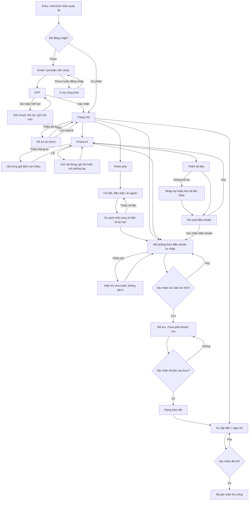

# 04 · Luồng và đường khôi phục

| Tác vụ                        | Điểm ra thành công                              | Quay lại / lỗi                                          |
| ----------------------------- | ----------------------------------------------- | ------------------------------------------------------- |
| OTP và onboarding             | Vào Home, có đường bỏ qua khi chưa sẵn sàng     | Sửa email, thử lại, giữ dữ kiện đã nhập                 |
| Home → hồ sơ                  | Tính được khả năng trả từ hồ sơ đã lưu          | Hồ sơ chưa đủ không hiển thị số 0 như kết quả           |
| AI                            | Có câu trả lời có giả định và hành động         | Giữ bản nháp khi lỗi; không tự lưu hay tạo nghĩa vụ     |
| Khám phá → so sánh → mô phỏng | So trên cùng cơ sở, nhập điều kiện thật khi cần | Thiếu phí hiện chưa biết; nguồn không đổi thành đề nghị |
| Tài liệu                      | Người dùng rà soát và xác nhận điều khoản       | Không hỗ trợ → nhập tay; không tự suy đoán              |
| Lưu → theo dõi → trả          | Ba trạng thái khác nhau được gọi rõ tên         | Hủy không ghi dữ liệu; lỗi ghi không báo thành công     |
| Quay lại                      | Hiểu kỳ tiếp theo hoặc lý do chưa có            | Không có nghĩa vụ → mở bản đã lưu, không tạo nợ giả     |
